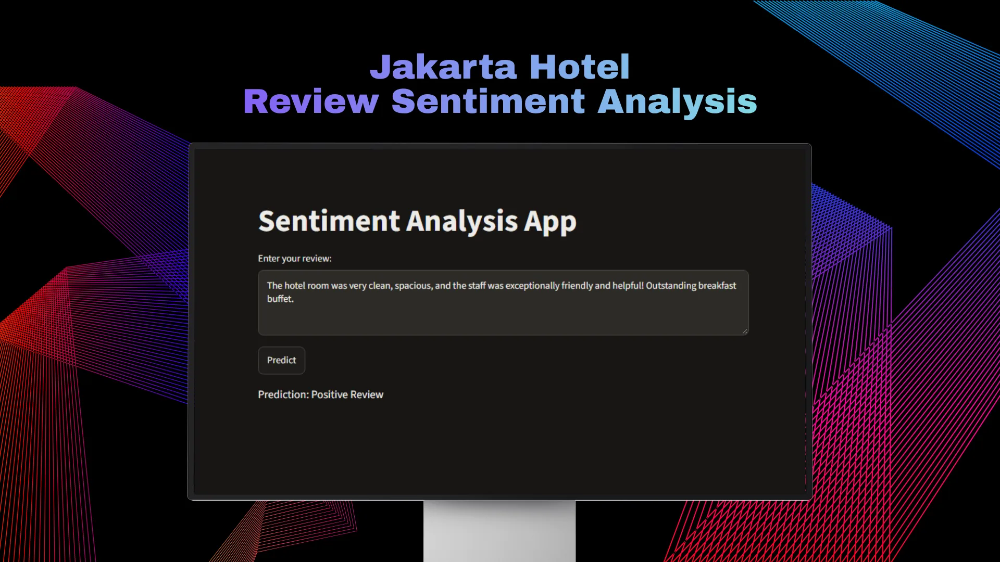
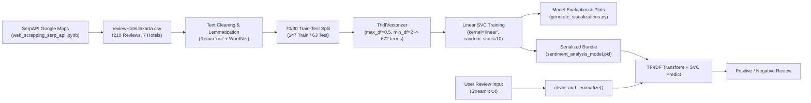
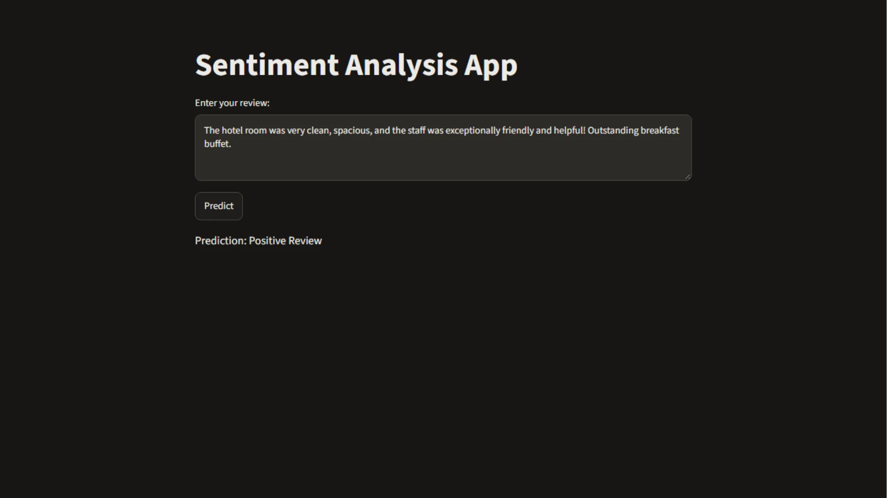
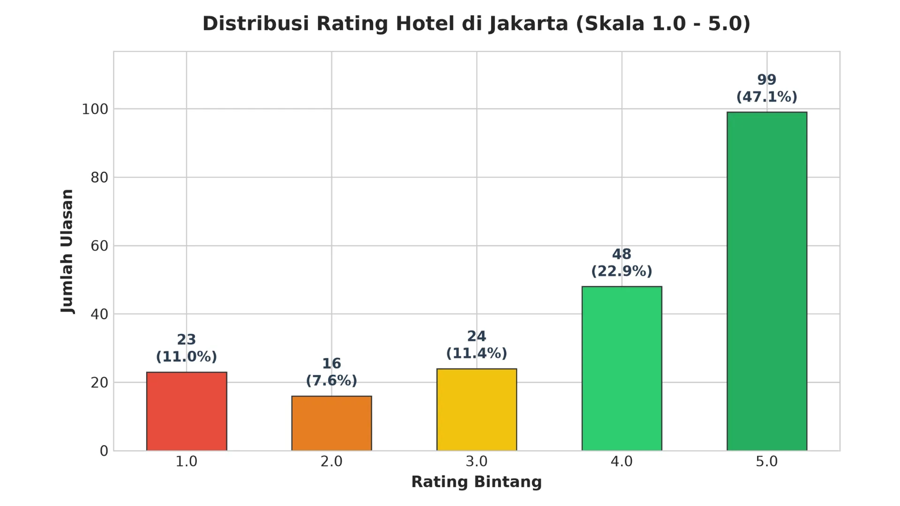
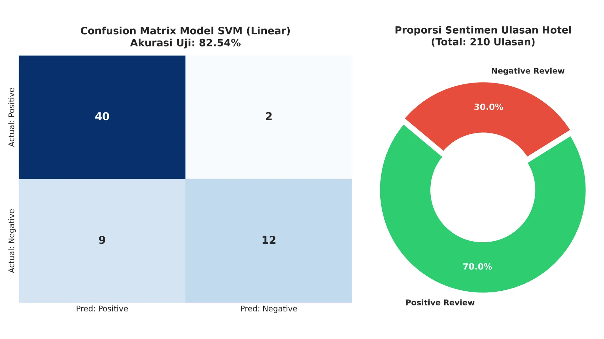
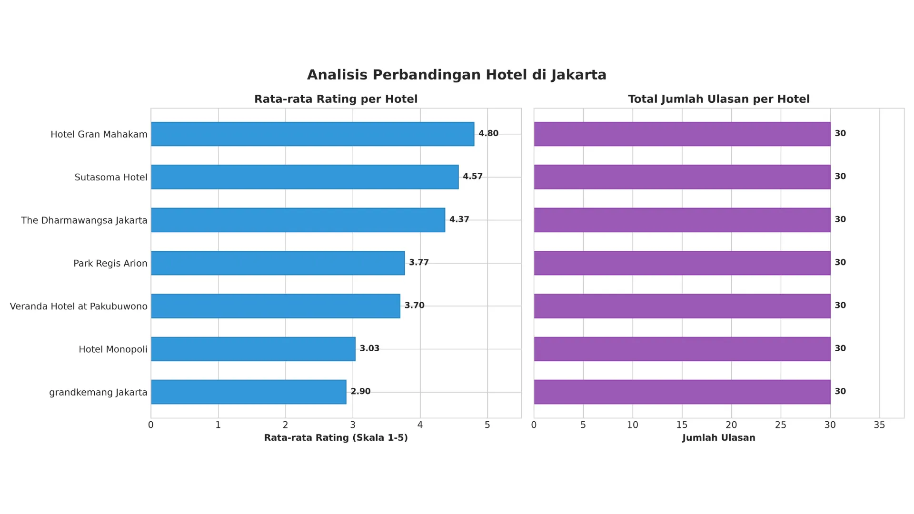
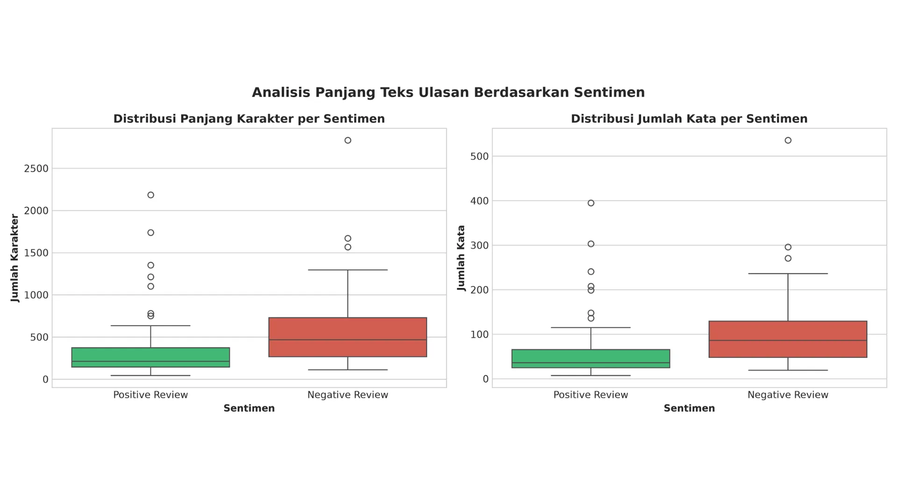
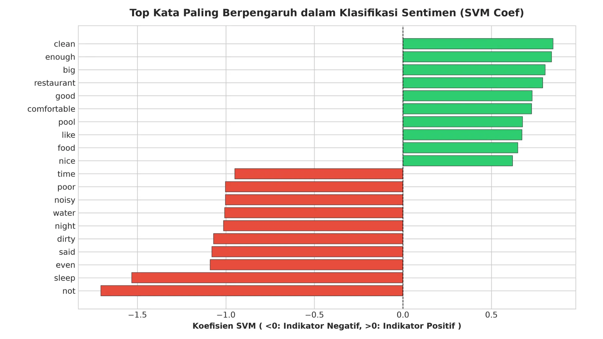
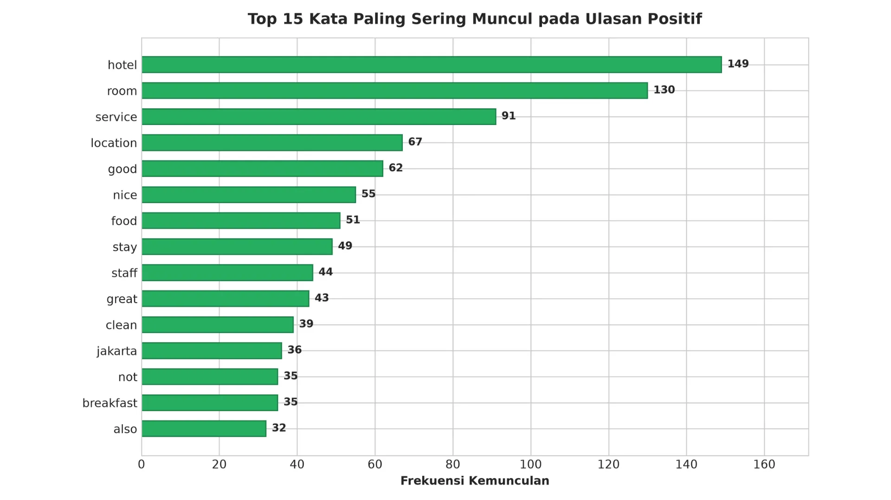
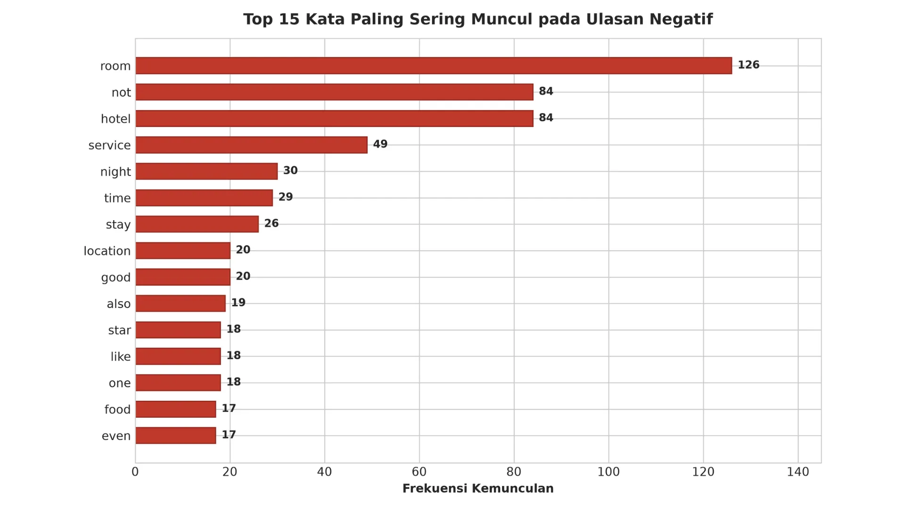

# Jakarta Hotel Review Sentiment Analysis




## Project Overview

Jakarta Hotel Review Sentiment Analysis is an end-to-end Natural Language Processing (NLP) and supervised machine learning project designed to automatically classify customer sentiment across Jakarta hotel reviews. The repository spans Google Maps review collection via SerpAPI, English text preprocessing with NLTK, TF-IDF feature extraction, Linear Support Vector Classification (`SVC`) modeling, diagnostic data visualizations, and an interactive Streamlit inference web application. By converting unstructured guest reviews into binary `Positive Review` and `Negative Review` predictions, the system supports rapid hospitality feedback evaluation for both hotel management and prospective travelers.

## Problem Statement & Objectives

Evaluating guest feedback manually across hospitality venues is time-consuming and prone to subjective interpretation due to varied expressions, negations, and fluctuating sentiment. To deliver consistent polarity assessment on Jakarta hotel review text, this project establishes an automated pipeline from data acquisition to interactive prediction.

- Collect real-world Google Maps hotel reviews across multiple Jakarta properties using SerpAPI.
- Standardize noisy review text through regex cleaning, negation-aware stopword filtering, and WordNet lemmatization.
- Transform preprocessed text into discriminative numerical representations using TF-IDF vectorization without train-test data leakage.
- Train and evaluate a Linear Support Vector Classifier (`SVC`) for binary sentiment classification (`Positive Review` vs. `Negative Review`).
- Interpret model decision drivers via linear SVM feature coefficients and expose real-time inference through a Streamlit UI.

## Data & Input Sources

The dataset is stored locally in [reviewHotelJakarta.csv](reviewHotelJakarta.csv) and was collected via [web_scrapping_serp_api.ipynb](web_scrapping_serp_api.ipynb) using SerpAPI (`google_maps` and `google_maps_reviews` engines) targeting hotels in Jakarta with at least 200 total reviews. It comprises 210 English-language customer review records balanced evenly across 7 hotels (30 reviews per hotel) with zero missing values. During interactive inference in [streamlit/app.py](streamlit/app.py), user-submitted review text serves as the runtime input.

| Attribute | Description |
| :--- | :--- |
| Dataset / Input Source | Jakarta Hotel Google Maps Reviews (`reviewHotelJakarta.csv`) & Interactive Streamlit User Input |
| Source | Scraped via SerpAPI Google Maps Reviews API ([web_scrapping_serp_api.ipynb](web_scrapping_serp_api.ipynb)) |
| Format | CSV (`latin-1` encoding) for batch training/evaluation; raw UTF-8 string for live Streamlit inference |
| Samples / Records | 210 reviews total across 7 Jakarta hotels (30 reviews per hotel; 147 train / 63 test split) |
| Features / Input Shape | 4 raw columns (`Hotel_name`, `name`, `rating`, `review`); 672 TF-IDF unigram features after vectorization |
| Target / Label | Binary `label` mapped from star `rating` (`1.0`–`3.0` -> `Negative Review` [63 / 30.0%]; `4.0`–`5.0` -> `Positive Review` [147 / 70.0%]) |

## Data Preprocessing & Feature Engineering

Because raw Google Maps reviews contain punctuation, mixed casing, and negation cues critical to sentiment polarity, meaningful text normalization and vectorization are implemented identically across [sentiment_analysis_model.ipynb](sentiment_analysis_model.ipynb), [scripts/generate_visualizations.py](scripts/generate_visualizations.py), and [streamlit/app.py](streamlit/app.py). Notably, the token `'not'` is explicitly retained from NLTK's English stopword list so negation phrases are preserved in feature weights.

| Transformation | Input | Output | Purpose |
| :--- | :--- | :--- | :--- |
| Rating Binarization | Numeric `rating` (`1.0`–`5.0`) | `Positive Review` / `Negative Review` | Maps `4.0`–`5.0` to positive and `1.0`–`3.0` to negative |
| Regex & Case Normalization | Raw `review` string | Lowercase alphabetic text | Strips punctuation, digits, and special characters (`[^a-zA-Z]`) |
| Negation-Preserving Stopword Filtering | Whitespace-split tokens | Filtered token list | Removes NLTK English stopwords while retaining `'not'` |
| WordNet Lemmatization | Filtered tokens | Space-joined canonical lemmas | Reduces inflected words to dictionary base forms via `WordNetLemmatizer` |
| TF-IDF Vectorization | `cleaned_text` (`X_train`) | Sparse/dense 672-dim TF-IDF matrix | Weights informative terms (`max_df=0.5`, `min_df=2`) fitted only on training data |

1. Drop non-predictive metadata columns (`Hotel_name`, `name`) during model training in [sentiment_analysis_model.ipynb](sentiment_analysis_model.ipynb).
2. Apply `clean_and_lemmatize(text)` to strip non-alphabetic characters, lowercase text, remove stopwords except `'not'`, and lemmatize tokens.
3. Map numerical `rating` values (`1.0`, `2.0`, `3.0` -> `Negative Review`; `4.0`, `5.0` -> `Positive Review`).
4. Split `cleaned_text` and `label` into 70% training (147 samples) and 30% test (63 samples) sets using `random_state=0`.
5. Fit `TfidfVectorizer(max_df=0.5, min_df=2)` exclusively on `X_train` (yielding 672 vocabulary features) and transform `X_test` independently to avoid data leakage.

## Tech Stack

| Category | Technology | Purpose |
| :--- | :--- | :--- |
| Programming Language | Python | Core language for data scraping, modeling, visualization, and web app |
| ML & NLP Libraries | Scikit-learn, NLTK | TF-IDF vectorization, Linear SVC classification, metrics, stopwords, WordNet lemmatization |
| Data Processing | Pandas, NumPy | Tabular CSV ingestion, label mapping, aggregation, and array coefficient sorting |
| Data Visualization | Matplotlib, Seaborn | Generating distribution plots, boxplots, confusion matrix, and feature importance charts |
| Data Acquisition | SerpAPI (`google-search-results`) | Scraping Jakarta hotel listings and Google Maps review snippets |
| Web Interface | Streamlit | Interactive sentiment prediction web application (`streamlit/app.py`) |
| Serialization | Pickle | Persisting and loading the `(tfidf, classifier)` model tuple (`.pkl`) |
| Notebooks & Documentation | Jupyter Notebook | Reproducible scraping and model training notebooks (`.ipynb`) |

## Machine Learning Approach

This project formulates hotel review sentiment analysis as a supervised binary text classification problem. Rather than relying on heavy deep neural networks on a compact 210-sample corpus, it pairs sparse TF-IDF n-gram weighting with a maximum-margin linear hyperplane classifier, providing strong generalization, fast CPU execution, and transparent token-level interpretability.

| Attribute | Details |
| :--- | :--- |
| Learning Paradigm | Supervised Learning |
| Problem Domain | Natural Language Processing (Hospitality Review Analytics) |
| ML Task | Binary Text Sentiment Classification |
| Input | Cleaned, lemmatized English hotel review text vectorized into 672 TF-IDF features |
| Target / Output | Binary class label: `Positive Review` or `Negative Review` |
| Approach | TF-IDF lexical weighting combined with a Linear Support Vector Classifier (`SVC`) |

## Model Overview

The primary and sole trained predictive model is a Scikit-learn Support Vector Classifier (`SVC`) configured with a linear kernel (`kernel='linear'`). Both the fitted `TfidfVectorizer` and trained `SVC` classifier are bundled together as a serialized tuple `(tfidf, classifier)` inside [sentiment_analysis_model.pkl](sentiment_analysis_model.pkl) and [streamlit/sentiment_analysis_model.pkl](streamlit/sentiment_analysis_model.pkl) so training and inference share identical vocabulary mappings.

| Attribute | Details |
| :--- | :--- |
| Model Name | Linear Support Vector Classifier (`SVC`) |
| Algorithm / Architecture | Maximum-margin linear hyperplane classifier over TF-IDF feature vectors |
| Model Type | Kernel-based Linear Classifier (`sklearn.svm.SVC`) |
| Framework | Scikit-learn |
| Input | 672-dimensional TF-IDF feature vector (`max_df=0.5`, `min_df=2`) |
| Output | Predicted class string (`Positive Review` or `Negative Review`) and decision margin |
| Pretrained Status | Trained from scratch on the 147-sample Jakarta hotel review training split |

## ML Workflow

The repository implements an end-to-end workflow documented across Jupyter notebooks, Python scripts, and [the academic documentation PDF](doc/Yohanes%20Dimas%20Pratama%20-%20Dokumentasi%20Aplikasi%20%28A11.2021.13254%20-%20A11.4705%29.pdf):

1. **Google Maps Review Scraping**: Query Jakarta hotels (>200 reviews) and extract 30 reviews per hotel across 7 properties into `reviewHotelJakarta.csv` via [web_scrapping_serp_api.ipynb](web_scrapping_serp_api.ipynb).
2. **Text Preprocessing & Labeling**: Clean review text, retain `'not'`, lemmatize with WordNet, and map 1–5 star ratings to binary sentiment labels in [sentiment_analysis_model.ipynb](sentiment_analysis_model.ipynb).
3. **Train-Test Split & TF-IDF Fitting**: Partition data 70/30 (`random_state=0`) and fit `TfidfVectorizer(max_df=0.5, min_df=2)` on training text.
4. **Model Training & Serialization**: Fit `SVC(kernel='linear', random_state=10)` on TF-IDF training vectors and export `(tfidf, classifier)` to `sentiment_analysis_model.pkl`.
5. **Evaluation & Visualization Generation**: Compute held-out test accuracy, confusion matrix, and linear SVM feature weights, saving 8 analytical figures via [scripts/generate_visualizations.py](scripts/generate_visualizations.py).
6. **Interactive Inference**: Load the serialized `(tfidf, classifier)` bundle in [streamlit/app.py](streamlit/app.py) to classify new user reviews on demand.

## ML Pipeline Architecture

The pipeline separates offline data collection, training, and evaluation from lightweight online inference. Training artifacts are persisted as a unified `(tfidf, classifier)` pickle bundle so that the Streamlit application applies the exact fitted TF-IDF vocabulary and linear hyperplane during real-time prediction.



## Model Training & Configuration

Training is executed in [sentiment_analysis_model.ipynb](sentiment_analysis_model.ipynb) and reproduced identically in [scripts/generate_visualizations.py](scripts/generate_visualizations.py) to refresh the serialized pickle file and generate diagnostic plots. No external GPU or distributed cluster is required; the 147-sample TF-IDF matrix trains on CPU in under a second.

| Parameter / Setting | Configured Value | Description |
| :--- | :--- | :--- |
| Train / Test Split | `test_size=0.3`, `random_state=0` | 147 training reviews (105 positive, 42 negative) and 63 test reviews (42 positive, 21 negative) |
| Vectorizer | `TfidfVectorizer(max_df=0.5, min_df=2)` | Filters corpus-ubiquitous terms (>50% docs) and rare hapax terms (<2 docs); 672 terms |
| Classifier | `SVC(kernel='linear', random_state=10)` | Linear-kernel Support Vector Classifier (`C=1.0` Scikit-learn default) |
| Stopword Rule | NLTK English stopwords minus `'not'` | Preserves critical negation polarity before TF-IDF weighting |
| Lemmatizer | `nltk.stem.WordNetLemmatizer()` | Normalizes token inflections prior to vectorization |
| Serialization | `pickle.dump((tfidf, classifier), ...)` | Stores vectorizer and classifier jointly for consistent inference |

```python
tfidf = TfidfVectorizer(max_df=0.5, min_df=2)
tfidf_train = tfidf.fit_transform(X_train)
classifier = SVC(kernel='linear', random_state=10)
classifier.fit(tfidf_train, y_train)
```

## Model Artifacts & Checkpoints

All model artifacts are generated directly by the project training pipeline (no externally downloaded pretrained weights are used). Both the root directory and `streamlit/` directory store the serialized tuple containing the fitted `TfidfVectorizer` and `SVC` classifier.

| Artifact | Format | Purpose | Location |
| :--- | :--- | :--- | :--- |
| `sentiment_analysis_model.pkl` | Python Pickle (`.pkl`) | Active serialized `(tfidf, classifier)` tuple for evaluation & scripts | [sentiment_analysis_model.pkl](sentiment_analysis_model.pkl) |
| `streamlit/sentiment_analysis_model.pkl` | Python Pickle (`.pkl`) | Serialized `(tfidf, classifier)` tuple loaded directly by the Streamlit app | [streamlit/sentiment_analysis_model.pkl](streamlit/sentiment_analysis_model.pkl) |
| `sentiment_analysis_model.pkl.orig_132` | Python Pickle backup | Original notebook-generated model checkpoint archive | [sentiment_analysis_model.pkl.orig_132](sentiment_analysis_model.pkl.orig_132) |

## Model Evaluation & Results

Model performance was evaluated on the held-out 30% test split (63 reviews: 42 `Positive Review`, 21 `Negative Review`) using [scripts/generate_visualizations.py](scripts/generate_visualizations.py) and Scikit-learn evaluation metrics. Training accuracy reaches `100.00%` on the 147 training samples due to linear separability in the 672-dimensional TF-IDF space, while held-out test accuracy reaches `82.54%` with a decision-function ROC-AUC of `0.9150`.

| Metric | Split | Value | Notes |
| :--- | :--- | :--- | :--- |
| Accuracy | Training (147 samples) | 100.00% | In-sample fit on 672-dim TF-IDF vectors |
| Accuracy | Test (63 samples) | 82.54% | 52 correct out of 63 held-out reviews (40 TP, 12 TN) |
| Precision (`Positive Review`) | Test (support: 42) | 0.8163 | High reliability with 9 false positives from negative reviews |
| Recall (`Positive Review`) | Test (support: 42) | 0.9524 | Captures 40 of 42 actual positive reviews (2 false negatives) |
| F1-Score (`Positive Review`) | Test (support: 42) | 0.8791 | Strong harmonic balance on majority positive class |
| Precision (`Negative Review`) | Test (support: 21) | 0.8571 | High precision when negative polarity is predicted |
| Recall (`Negative Review`) | Test (support: 21) | 0.5714 | 12 of 21 negative reviews recalled; 9 misclassified as positive |
| F1-Score (`Negative Review`) | Test (support: 21) | 0.6857 | Impacted by 70/30 class imbalance and 3-star mixed reviews |
| Macro Avg F1 / Weighted Avg F1 | Test (63 samples) | 0.7824 / 0.8147 | Overall cross-class classification balance |
| ROC-AUC | Test (63 samples) | 0.9150 | Computed from linear SVC `decision_function` scores |

- **Class Imbalance Impact**: Positive reviews represent 70.0% of the corpus, skewing linear margin boundaries toward positive predictions and lowering `Negative Review` recall (`57.14%`).
- **3-Star Mapping Ambiguity**: Mapping `3.0`-star mixed reviews entirely to `Negative Review` introduces positive-sounding praise phrases inside negative-labeled records, contributing to the 9 false-positive errors.
- **Language Scope**: As noted in the project documentation, the NLTK English stopword/lemmatization pipeline and English review corpus restrict reliable predictions to English-language hotel reviews.

## Model Explainability & Interpretability

Because `SVC(kernel='linear')` learns an explicit weight vector over the 672 TF-IDF vocabulary features, [scripts/generate_visualizations.py](scripts/generate_visualizations.py) inspects `classifier.coef_` directly to rank the strongest positive and negative sentiment indicators (visualized in `screenshots/image6.webp`).

| Polarity | Top Indicative Tokens (Linear SVC Coefficient) | Behavioral Insight |
| :--- | :--- | :--- |
| Positive Indicators (`coef > 0`) | `clean` (+0.8482), `enough` (+0.8398), `big` (+0.8036), `restaurant` (+0.7902), `good` (+0.7295) | Room cleanliness, spaciousness, dining amenities, and general satisfaction drive positive scores |
| Negative Indicators (`coef < 0`) | `not` (-1.7070), `sleep` (-1.5315), `even` (-1.0891), `said` (-1.0793), `dirty` (-1.0702) | Explicit negation (`not`), sleep disruption (`sleep`, `noisy`), and hygiene issues (`dirty`) anchor negative predictions |

## Results Visualization & Preview

### 1. Streamlit Web Application Inference UI

The interactive Streamlit web interface (`streamlit/app.py`) receiving a sample positive hotel review and rendering the real-time `Prediction: Positive Review` output from the loaded TF-IDF and Linear SVC pipeline.

### 2. Hotel Star Rating Distribution (1.0–5.0 Scale)

Bar chart of star ratings across all 210 scraped reviews, showing a strong positive skew led by 5.0-star (99 reviews / 47.1%) and 4.0-star (48 reviews / 22.9%) ratings compared to 1.0-star (23 / 11.0%), 2.0-star (16 / 7.6%), and 3.0-star (24 / 11.4%) entries.

### 3. Linear SVM Confusion Matrix & Sentiment Class Proportion

Side-by-side view of the held-out test confusion matrix (82.54% test accuracy with 40 true positives, 12 true negatives, 9 false positives, and 2 false negatives) alongside the dataset donut chart illustrating the 70.0% positive versus 30.0% negative class split.

### 4. Average Rating & Review Count Comparison Across Jakarta Hotels

Horizontal comparison across the seven scraped Jakarta properties (30 reviews sampled per hotel), highlighting average rating dispersion from Hotel Gran Mahakam (4.80) and Sutasoma Hotel (4.57) down to Hotel Monopoli (3.03) and grandkemang Jakarta (2.90).

### 5. Review Text Character Length & Word Count by Sentiment

Boxplots comparing character counts and word counts between sentiment classes, demonstrating that negative reviews are substantially longer (median 468 characters / 86 words) than positive reviews (median 212 characters / 36 words) because dissatisfied guests write more detailed complaints.

### 6. Top Linear SVM Feature Importance Coefficients

Diverging horizontal bar chart of the top 10 positive and top 10 negative TF-IDF token weights learned by the linear SVC model, confirming `clean`, `enough`, `big`, and `restaurant` as primary positive drivers while `not` (-1.71) and `sleep` (-1.53) dominate negative classification.

### 7. Top 15 Most Frequent Words in Positive Reviews

Frequency bar chart of the most common lemmatized tokens in 4- and 5-star reviews, dominated by hospitality staples such as `hotel` (149), `room` (130), `service` (91), `location` (67), `good` (62), and `nice` (55).

### 8. Top 15 Most Frequent Words in Negative Reviews

Frequency bar chart of the top 15 lemmatized tokens in 1- to 3-star reviews, where `room` (126), the preserved negation token `not` (84), `hotel` (84), `service` (49), and `night` (30) highlight recurring dissatisfaction themes.

## Prerequisites

- Python 3.10 or 3.12 (compatible with Scikit-learn, Pandas, NLTK, and Streamlit)
- `pip` package manager (with optional `venv` virtual environment support)
- Core Python packages: `scikit-learn`, `nltk`, `pandas`, `numpy`, `matplotlib`, `seaborn`, `streamlit`
- Optional scraping dependency: `google-search-results` (only needed if re-running SerpAPI collection in `web_scrapping_serp_api.ipynb` with your own API key)
- Compute requirement: Standard CPU execution only; no GPU or CUDA device is required
- NLTK lexical data (`stopwords`, `wordnet`, `omw-1.4`), downloaded automatically on first run

## Installation & Setup

1. Clone the repository and enter the project directory:
   ```bash
   git clone https://github.com/weztcy/Jakarta-Hotel-Review-Sentiment-Analysis.git
   cd "Jakarta Hotel Review Sentiment Analysis"
   ```
2. Create and activate a Python virtual environment (recommended):
   ```bash
   python -m venv venv
   # Windows PowerShell:
   .\venv\Scripts\Activate.ps1
   # macOS/Linux:
   source venv/bin/activate
   ```
3. Install the required libraries for modeling, visualization, and the Streamlit app:
   ```bash
   pip install scikit-learn nltk pandas numpy matplotlib seaborn streamlit
   ```

## Usage & Execution

You can either launch the pre-trained Streamlit web application for interactive review prediction or run the training and visualization script against `reviewHotelJakarta.csv`.

1. Launch the interactive Streamlit sentiment prediction app from the `streamlit/` directory (where `streamlit/sentiment_analysis_model.pkl` resides):
   ```bash
   cd streamlit
   streamlit run app.py
   ```
2. Enter any English hotel review into the text area and click **Predict** to obtain a `Positive Review` or `Negative Review` classification.
3. To re-run the full training, evaluation, and figure generation pipeline from the repository root:
   ```bash
   python scripts/generate_visualizations.py
   ```
4. Alternatively, open and execute [sentiment_analysis_model.ipynb](sentiment_analysis_model.ipynb) in Jupyter Notebook or VS Code to inspect step-by-step preprocessing, TF-IDF fitting, and model serialization.

## Reproducibility & Execution

Model training and test evaluation are deterministic given the repository's local dataset [reviewHotelJakarta.csv](reviewHotelJakarta.csv) and fixed random seeds, whereas live web scraping depends on external Google Maps API state.

1. **Deterministic Training & Split**: Running `python scripts/generate_visualizations.py` or executing all cells in [sentiment_analysis_model.ipynb](sentiment_analysis_model.ipynb) uses `train_test_split(..., test_size=0.3, random_state=0)` and `SVC(kernel='linear', random_state=10)`, reproducing the 82.54% test accuracy and exact confusion matrix on `reviewHotelJakarta.csv`.
2. **NLTK Corpora Dependency**: Both training and inference download `stopwords`, `wordnet`, and `omw-1.4` from NLTK; consistent lemmatization requires these corpora to be present.
3. **Environment & Scraping Limitations**: The repository does not include a pinned `requirements.txt` lockfile, so pickle compatibility depends on matching Scikit-learn major/minor versions when deserializing `sentiment_analysis_model.pkl` (re-running `scripts/generate_visualizations.py` refreshes the `.pkl` file for your local Scikit-learn version). Re-running `web_scrapping_serp_api.ipynb` requires a valid SerpAPI key and will fetch updated live reviews rather than the 2023 snapshot.

## Contributing

Contributions are welcome to improve text preprocessing, address class imbalance, or extend multilingual support.

1. Fork the repository.
2. Create a branch for the change (`git checkout -b feature/your-feature`).
3. Make the changes cleanly while preserving reproducibility.
4. Run `python scripts/generate_visualizations.py` and verify `streamlit run app.py` launches without errors.
5. Commit and push the branch to your fork.
6. Open a pull request with a clear explanation of your changes.

## License

This project is licensed under the MIT License.
See the [LICENSE](LICENSE) file for details.

## Author & Contact

**Yohanes Dimas Pratama**

- GitHub: [github.com/weztcy](https://github.com/weztcy)
- Portfolio: [yohanesdimas.com](https://yohanesdimas.com)
- LinkedIn: [linkedin.com/in/yohanes-dimas](https://www.linkedin.com/in/yohanes-dimas)
