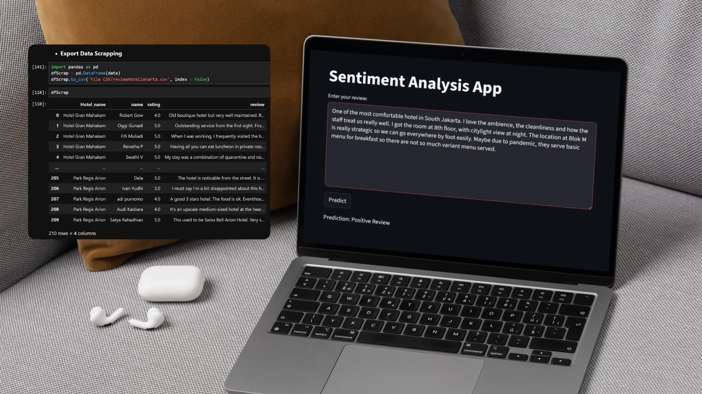
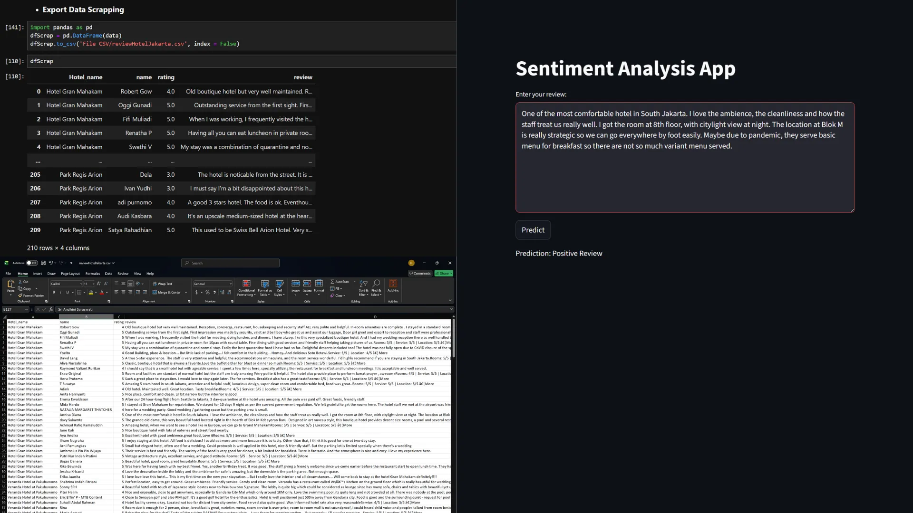

# Jakarta Hotel Review Sentiment Analysis




## Project Overview

Jakarta Hotel Review Sentiment Analysis is an end-to-end machine learning system developed to automatically classify hotel customer reviews in South Jakarta into positive and negative sentiments. The project addresses the challenges of manual guest feedback processing by combining automated data extraction via SerpAPI (Google Maps Reviews engine), rigorous natural language preprocessing with NLTK, sparse text feature representation using TF-IDF Vectorization, and supervised classification via a Linear Support Vector Classifier (SVC). In addition to computational modeling, the system delivers an interactive Streamlit web application that enables hotel managers, prospective travelers, and hospitality analysts to evaluate arbitrary review text with instantaneous inference.

## Problem Statement & Objectives

Hospitality management teams frequently face difficulty synthesizing thousands of unstructured online reviews across varied digital booking platforms. Fluctuating customer sentiment, nuanced textual expressions, and subjective numerical star ratings create analytical ambiguity, leading to delayed operational responses and unaddressed service bottlenecks.

- Automate the extraction of structured hotel review datasets from Google Maps using SerpAPI for major accommodations in South Jakarta.
- Implement an NLP text cleaning and lemmatization pipeline capable of preserving essential sentiment modifiers (such as negation keywords).
- Train and validate a high-accuracy Support Vector Classifier (SVC) tailored to binary sentiment polarity prediction.
- Package the trained model artifact into a lightweight, user-friendly Streamlit web interface for real-time customer feedback assessment.

## Data & Input Sources

The project utilizes customer review data extracted directly from Google Maps using SerpAPI's review search engine, targeting prominent South Jakarta hospitality establishments. The dataset captures genuine guest feedback spanning room cleanliness, staff responsiveness, dining quality, and overall ambiance across multiple hotel tiers.

| Attribute | Description |
| --- | --- |
| Dataset / Input Source | Google Maps Reviews via SerpAPI |
| Source | [reviewHotelJakarta.csv](reviewHotelJakarta.csv) |
| Format | Tabular CSV |
| Samples / Records | 210 guest reviews (30 reviews across 7 hotels) |
| Features / Input Shape | 4 attributes (`Hotel_name`, `name`, `rating`, `review`) |
| Target / Label | Binary sentiment (`Positive Review`, `Negative Review`) mapped from numerical ratings |

## Data Preprocessing & Feature Engineering

To transform unstructured, noisy review text into high-dimensional numerical vectors optimized for maximum-margin classification, the dataset undergoes systematic cleaning, linguistic normalization, and TF-IDF feature extraction.

| Transformation | Input | Output | Purpose |
| --- | --- | --- | --- |
| Regex Sanitization | Raw review text | Alphabetical strings | Eliminates punctuation, digits, and special characters |
| Lowercasing | Sanitized string | Uniform lowercase tokens | Standardizes case sensitivity across vocabulary |
| Stopword Removal | Token sequence | Filtered tokens | Removes non-informative words while preserving "not" for sentiment context |
| WordNet Lemmatization | Filtered tokens | Base morphological lemmas | Collapses inflected words into standard root dictionary forms |
| TF-IDF Vectorization | Cleaned review texts | 672-dimensional sparse matrix | Computes unigram term frequency-inverse document frequency weights |

1. Text sanitization removes all non-alphabetical characters using regular expressions (`[^a-zA-Z]`) and converts characters to lowercase.
2. English stop words are filtered via NLTK, explicitly retaining the negation term `not` to preserve sentiment inversion.
3. Tokens are normalized using WordNet Lemmatizer to reduce morphological variants to their lemma roots.
4. Numerical conversion is executed using `TfidfVectorizer(max_df=0.5, min_df=2)` on training splits, producing 672 unigram features.

## Tech Stack

| Category | Technology | Purpose |
| --- | --- | --- |
| Programming Language | Python 3 | Core development, data wrangling, and modeling language |
| Machine Learning Framework | Scikit-Learn | TF-IDF feature extraction, train-test splitting, and Linear SVC model training |
| Natural Language Processing | NLTK | Stopword corpus curation, WordNet lemmatization, and lexical normalization |
| Web Scraping Engine | SerpAPI (GoogleSearch) | Automated query extraction of Google Maps hotel reviews and ratings |
| Web Application Framework | Streamlit | Lightweight reactive web dashboard for interactive real-time model inference |
| Data Manipulation & Serialization | Pandas, Pickle | Tabular dataset management and serialized binary model artifact persistence |

## Machine Learning Approach

The problem is formulated as a supervised binary classification task. The primary objective is to map preprocessed textual feedback into discrete sentiment classes: positive sentiment (derived from 4.0 and 5.0 star ratings) versus negative sentiment (derived from 1.0, 2.0, and 3.0 star ratings).

| Attribute | Specification |
| --- | --- |
| Learning Paradigm | Supervised Learning |
| Problem Domain | Natural Language Processing (NLP) / Sentiment Analysis |
| ML Task | Binary Text Classification |
| Input Modality | Lemmatized text representations vectorized via TF-IDF |
| Target Output | `Positive Review` (70%) vs `Negative Review` (30%) |
| Modeling Technique | Linear Support Vector Classification (Linear SVC) |

## Model Overview

The chosen architecture is a Support Vector Classifier utilizing a linear kernel. Linear SVC is well suited for high-dimensional, sparse text classification problems where the number of features is large relative to the number of training samples, providing robust generalization and resistance to overfitting.

| Attribute | Specification |
| --- | --- |
| Model Name | Support Vector Classifier (SVC) |
| Algorithm / Architecture | Linear Support Vector Machine with coordinate descent optimization |
| Model Type | Maximum-margin linear hyperplane classifier |
| Framework | Scikit-Learn |
| Input Dimensions | 672 sparse TF-IDF unigram features |
| Output Dimensions | 2 sentiment classes (`Negative Review`, `Positive Review`) |
| Pretrained Status | Trained from scratch on project dataset |

## ML Workflow

1. **Web Scraping & Data Acquisition**: Collect hotel metadata and customer reviews across South Jakarta using SerpAPI Google Maps search queries, documented in [web_scrapping_serp_api.ipynb](web_scrapping_serp_api.ipynb).
2. **Data Export & Structuring**: Compile extracted review records into [reviewHotelJakarta.csv](reviewHotelJakarta.csv) comprising 210 instances with hotel name, reviewer handle, rating score, and raw text.
3. **Text Preprocessing & Label Encoding**: Apply regex filtering, stopword exclusion (preserving negation), WordNet lemmatization, and binary rating mapping (ratings 1–3 as Negative, 4–5 as Positive).
4. **Holdout Partitioning**: Partition the preprocessed data into an independent 70% training set (147 samples) and 30% testing set (63 samples) using fixed random state 0.
5. **Feature Extraction**: Fit a TF-IDF vectorizer on training text (`max_df=0.5, min_df=2`) and project both partitions into 672-dimensional feature space.
6. **Model Training & Fitting**: Train a linear SVC (`kernel='linear', random_state=10, C=1.0`) on the vectorized training matrix as demonstrated in [sentiment_analysis_model.ipynb](sentiment_analysis_model.ipynb).
7. **Model Serialization**: Persist the fitted TF-IDF vectorizer and trained SVC classifier into [sentiment_analysis_model.pkl](sentiment_analysis_model.pkl).
8. **Application Deployment**: Construct an interactive web user interface in [app.py](app.py) powered by Streamlit for interactive real-time review inference.
9. **Empirical Evaluation**: Evaluate classifier generalization across test metrics including accuracy, precision, recall, and macro F1-score.

## ML Pipeline Architecture

The end-to-end pipeline connects web scraping data ingestion to feature engineering, supervised hyperplane fitting, artifact persistence, and interactive user inference.

```mermaid
flowchart LR
    A["SerpAPI Google Maps"] -->|"Extract Reviews"| B["reviewHotelJakarta.csv (210 Rows)"]
    B --> C["Label Mapping (1-3: Neg, 4-5: Pos)"]
    C --> D["NLTK Preprocessing (Clean & Lemmatize)"]
    D --> E["Train/Test Split (70% / 30%)"]
    E --> F["TF-IDF Vectorizer (672 Features)"]
    F --> G["Linear SVC Training (C=1.0, random_state=10)"]
    G --> H["Model Artifact (sentiment_analysis_model.pkl)"]
    H --> I["Streamlit Web App (app.py)"]
    I --> J["Real-Time Sentiment Prediction"]
```



The pipeline ingests raw reviews from Google Maps via SerpAPI, applies threshold-based sentiment labeling and NLTK text processing, vectorizes tokens via TF-IDF, trains a maximum-margin linear SVC, and serves the serialized model through a Streamlit web application.

## Model Training & Configuration

Training was conducted from scratch on the 147 preprocessed training samples. The linear Support Vector Classifier was configured with standard hinge loss, coordinate descent optimization, and a fixed random seed to guarantee deterministic boundary fitting.

| Parameter | Configuration Value | Description |
| --- | --- | --- |
| Kernel | `linear` | Standard linear dot-product kernel |
| Regularization Parameter ($C$) | `1.0` | Balanced penalty between margin maximization and slack violation |
| Random State | `10` | Seed ensuring deterministic coordinate descent convergence |
| Decision Function | `ovr` | One-vs-rest decision function shape |
| Tolerance (`tol`) | `1e-3` | Convergence stopping criterion tolerance |
| Vectorizer Max DF | `0.5` | Filters unigrams appearing in over 50% of documents |
| Vectorizer Min DF | `2` | Filters unigrams appearing in fewer than 2 documents |

```python
from sklearn.model_selection import train_test_split
from sklearn.feature_extraction.text import TfidfVectorizer
from sklearn.svm import SVC
import pickle

# Train-test split
X_train, X_test, y_train, y_test = train_test_split(X, y, test_size=0.3, random_state=0)

# Feature extraction
tfidf = TfidfVectorizer(max_df=0.5, min_df=2)
tfidf_train = tfidf.fit_transform(X_train)

# Model initialization and training
classifier = SVC(kernel='linear', random_state=10)
classifier.fit(tfidf_train, y_train)

# Save artifact
with open("sentiment_analysis_model.pkl", "wb") as model_file:
    pickle.dump((tfidf, classifier), model_file)
```

## Model Artifacts & Checkpoints

The project serializes both the preprocessing vectorizer and the classification model into a unified binary file, ensuring reproducible text transformation during production inference without external dependencies.

| Artifact Name | Format | Size | Description & Loading Target |
| --- | --- | --- | --- |
| [sentiment_analysis_model.pkl](sentiment_analysis_model.pkl) | Pickle Binary (`.pkl`) | ~69 KB | Serialized Python tuple `(tfidf, classifier)` containing the fitted `TfidfVectorizer` and trained `SVC` estimator |

## Model Evaluation & Results

The classifier was evaluated on the independent holdout test set comprising 63 customer reviews (42 positive and 21 negative instances). Performance was assessed using accuracy, precision, recall, and macro F1-score.

| Metric | Training Split (147 Samples) | Test Holdout (63 Samples) |
| --- | --- | --- |
| Accuracy | 100.0% (1.0000) | 82.54% (0.8254) |
| Macro Precision | 100.0% (1.0000) | 83.67% (0.8367) |
| Macro Recall | 100.0% (1.0000) | 76.19% (0.7619) |
| Macro F1-Score | 100.0% (1.0000) | 78.24% (0.7824) |

| Sentiment Class | Precision | Recall | F1-Score | Support |
| --- | --- | --- | --- | --- |
| Negative Review | 0.86 | 0.57 | 0.69 | 21 |
| Positive Review | 0.82 | 0.95 | 0.88 | 42 |

- The model achieves an overall test accuracy of 82.54%, correctly classifying 52 out of 63 unseen test reviews.
- High recall of 95% on the positive class demonstrates strong capability in detecting favorable customer feedback with minimal false negatives.
- The negative class demonstrates high precision of 86%, meaning predicted negative reviews are reliable and contain minimal false alarms.
- The test confusion matrix records 12 True Negatives, 9 False Positives, 2 False Negatives, and 40 True Positives.

## Results Visualization & Preview

### 1. Web Scraping Data Extraction & Streamlit Prediction Interface

The visualization presents the complete operational pipeline, featuring the automated SerpAPI web scraping output in Google Colab, the structured 210-row hotel review dataset in Excel, and the live Streamlit interactive user interface classifying arbitrary guest reviews into positive sentiment in real time.

## Prerequisites

- Operating System: Windows 10/11, macOS, or Linux
- Python Runtime: Python 3.8 to 3.12 (Python 3.10+ recommended)
- Package Manager: `pip`
- Hardware Compute: Standard x86_64 CPU (GPU acceleration is not required)
- Network Access: Internet access required only for downloading NLTK corpora (`stopwords`, `wordnet`, `omw-1.4`) upon initial execution

## Installation & Setup

1. **Clone the Repository**:
   ```bash
   git clone https://github.com/weztcy/jakarta-hotel-review-sentiment-analysis.git
   cd "jakarta-hotel-review-sentiment-analysis"
   ```

2. **Create and Activate a Virtual Environment** (Optional but recommended):
   ```bash
   python -m venv venv
   # On Windows:
   .\venv\Scripts\activate
   # On macOS/Linux:
   source venv/bin/activate
   ```

3. **Install Required Dependencies**:
   ```bash
   pip install streamlit scikit-learn nltk pandas google-search-results
   ```

4. **Verify NLTK Resource Downloads**:
   Run a one-line Python check to ensure required corpora are cached:
   ```bash
   python -c "import nltk; nltk.download('stopwords'); nltk.download('wordnet'); nltk.download('omw-1.4')"
   ```

## Usage & Execution

1. **Launch the Streamlit Web Application**:
   Execute the Streamlit application runner from the project root:
   ```bash
   streamlit run app.py
   ```

2. **Access the Web Interface**:
   Open a web browser and navigate to the local server URL (typically `http://localhost:8501`).

3. **Perform Real-Time Review Sentiment Analysis**:
   - Enter or paste an English hotel review into the text area.
   - Click the **Predict** button.
   - View the instantaneous classification output (`Positive Review` or `Negative Review`).

4. **Execute Model Training from Notebook**:
   Open and execute [sentiment_analysis_model.ipynb](sentiment_analysis_model.ipynb) within Jupyter Notebook or VS Code to retrain the classifier and regenerate [sentiment_analysis_model.pkl](sentiment_analysis_model.pkl).

5. **Execute Web Scraping Routine**:
   Open [web_scrapping_serp_api.ipynb](web_scrapping_serp_api.ipynb) to inspect or execute custom hotel review extraction workflows via SerpAPI.

## Model Deployment & Serving

The sentiment analysis application is deployed locally as an interactive micro-service using Streamlit. The application architecture encapsulates preprocessing, feature transformation, and inference in a lightweight reactive execution loop.

1. **Inference Script Structure**: [app.py](app.py) handles model unpickling, text lemmatization, sparse TF-IDF matrix projection, and linear hyperplane evaluation upon button click.
2. **Local Serving Command**:
   ```bash
   streamlit run app.py --server.port 8501 --server.address localhost
   ```
3. **Cloud Deployment Readiness**: The Streamlit application can be deployed directly to cloud container environments such as Streamlit Community Cloud, AWS Elastic Beanstalk, or Heroku by specifying `app.py` as the entrypoint.

## Reproducibility & Execution

To replicate the experimental results documented in this repository:

1. **Environment Consistency**: Utilize Python 3.10 or 3.12 with `scikit-learn==1.3.2` and `nltk==3.8+` to maintain identical estimator serialization and tokenization behavior.
2. **Deterministic Partitions**: Ensure the train-test split in [sentiment_analysis_model.ipynb](sentiment_analysis_model.ipynb) retains `test_size=0.3` and `random_state=0`.
3. **Hyperplane Optimization**: Set the SVC classifier parameter `random_state=10` with `kernel='linear'` and `C=1.0`.
4. **Vocabulary Thresholds**: Ensure the TF-IDF vectorizer configuration uses `max_df=0.5` and `min_df=2` to reproduce the exact 672-feature vocabulary.

## Contributing

1. Fork the repository.
2. Create a branch for the change (`git checkout -b feature/enhancement-name`).
3. Make the changes with appropriate code documentation and unit validation.
4. Run relevant checks or tests when available.
5. Commit and push the branch (`git push origin feature/enhancement-name`).
6. Open a pull request with a clear explanation of proposed improvements.

## License

This project is licensed under the MIT License.
See the [LICENSE](LICENSE) file for details.

## Author & Contact

**Yohanes Dimas Pratama**

- GitHub: [github.com/weztcy](https://github.com/weztcy)
- Portfolio: [yohanesdimas.com](https://yohanesdimas.com)
- LinkedIn: [linkedin.com/in/yohanes-dimas](https://www.linkedin.com/in/yohanes-dimas)
