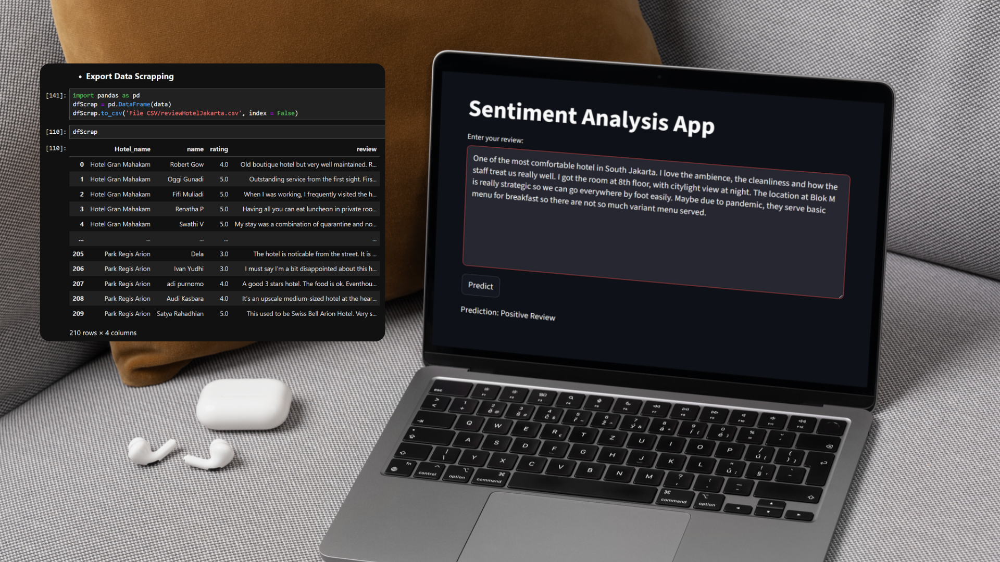
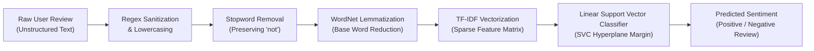
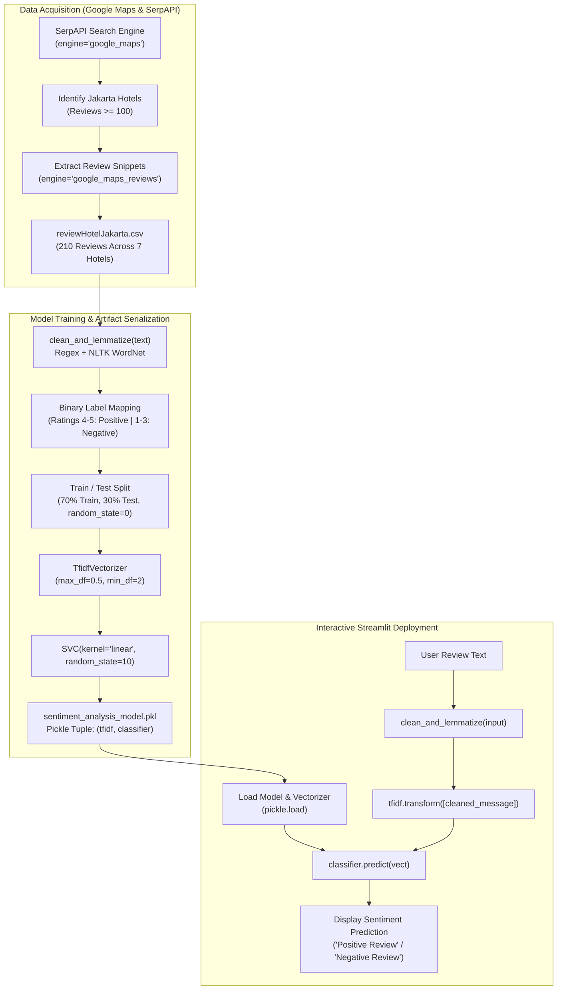

# Jakarta Hotel Review Sentiment Analysis

[](https://www.python.org/)
[](https://streamlit.io/)
[](https://scikit-learn.org/)
[](https://www.nltk.org/)
[](https://pandas.pydata.org/)
[](https://serpapi.com/)
[](https://jupyter.org/)
[](./LICENSE)



**Jakarta Hotel Review Sentiment Analysis** is an end-to-end natural language processing (NLP) and machine learning project engineered to automatically harvest, preprocess, model, and classify customer feedback from hotels across Jakarta, Indonesia.

Guest reviews on platforms such as Google Maps contain critical insights regarding hospitality standards, facilities, room cleanliness, food quality, and service levels. However, manually reading and analyzing large volumes of unstructured natural language text is time-consuming, labor-intensive, and subjective. This project addresses the challenge by constructing an automated pipeline: extracting live Google Maps reviews using SerpAPI, cleaning and lemmatizing text with NLTK (preserving vital negation terms such as "not"), transforming unstructured tokens into numerical vector representations via Term Frequency-Inverse Document Frequency (TF-IDF), training a maximum-margin Support Vector Classifier (`SVC(kernel='linear')`), and deploying the model through an interactive Streamlit web application for real-time sentiment inference.

---

## Objectives & Use Cases

- **Automated Sentiment Classification**: Categorize unstructured English customer feedback into binary sentiment polarity (`Positive Review` vs. `Negative Review`) with high discriminative boundary accuracy.
- **Automated Data Harvesting via SerpAPI**: Mine localized Google Maps hotel reviews across Jakarta using pagination and search parameters, compiling metadata including reviewer identity, numerical rating, and raw review snippets.
- **Negation-Preserving NLP Normalization**: Sanitize raw text by stripping non-alphabetic noise, converting tokens to lowercase, performing WordNet lemmatization, and removing stopwords while deliberately retaining the negation term `"not"` to preserve sentiment polarity.
- **High-Dimensional Text Vectorization**: Extract statistical term importance features across the review corpus using scikit-learn's `TfidfVectorizer` with document frequency bounds (`max_df=0.5, min_df=2`).
- **Interactive Web Inference**: Deliver an accessible graphical interface via Streamlit enabling hospitality managers, prospective travelers, and researchers to test arbitrary hotel review texts and receive immediate sentiment predictions.
- **Operational Hospitality Intelligence**: Help hotel management rapidly detect customer satisfaction trends, identify recurring service complaints, and optimize guest experiences.

---

## Features

- **Automated Google Maps Scraping Pipeline**:
  - Leverages SerpAPI (`google_maps` and `google_maps_reviews` search engines) to programmatically harvest reviews from hotels located in Jakarta with $\ge 100$ total reviews.
  - Automatically iterates through pagination parameters (`serpapi_pagination`) to collect structured review batches.
- **Customized NLP Text Preprocessing Engine**:
  - Regular expression sanitization (`re.sub('[^a-zA-Z]', ' ', text)`) and lowercase normalization.
  - English stopword filtering with negation preservation (`all_stopwords.remove('not')`) to prevent reversing critical sentiment cues (e.g., "not clean", "not comfortable").
  - Lemmatization powered by `nltk.stem.WordNetLemmatizer` utilizing WordNet and Open Multilingual Wordnet (`omw-1.4`) corpora to reduce inflected word variants to morphological bases.
- **TF-IDF Feature Representation**:
  - Configured with `max_df=0.5` to eliminate ubiquitous corpus terms and `min_df=2` to filter singleton tokens, preventing vocabulary inflation while preserving predictive discriminability.
- **Linear Support Vector Classification (SVC)**:
  - Fits a maximum-margin hyperplane separating binary sentiment classes in sparse high-dimensional feature space (`kernel='linear'`, `random_state=10`).
- **Dual Pipeline Serialization**:
  - Persists the fitted `TfidfVectorizer` alongside the trained `SVC` classifier into a single serialized tuple artifact (`sentiment_analysis_model.pkl`), ensuring zero feature-space mismatch between offline training and live production serving.
- **Real-Time Streamlit Web Application**:
  - Clean web dashboard built with Streamlit featuring a multiline text area input, instantaneous evaluation button, and dynamic prediction display.

---

## Preview & Demo


*Left: Google Colab web scraping extraction script exporting Google Maps reviews to structured CSV (`reviewHotelJakarta.csv`, 210 rows) and tabular inspection in Microsoft Excel. Right: Interactive Streamlit web application (`app.py`) performing live sentiment inference on customer reviews.*

### Observed Prediction Examples

| Input Review Text | Expected Polarity | Streamlit Prediction |
| :--- | :---: | :---: |
| *"One of the most comfortable hotel in South Jakarta. I love the ambience, the cleanliness and how the staff treat us really well. I got the room at 8th floor, with citylight view at night. The location at Blok M is really strategic so we can go everywhere by foot easily..."* | Positive | `Positive Review` |
| *"The hotel is noticable from the street. It is a good 3 stars hotel. The food is ok. Eventhough I must say I'm a bit disappointed about this stay..."* | Negative | `Negative Review` |
| *"Old boutique hotel but very well maintained. Reception, concierge, restaurant, housekeeping and security staff ALL very polite and helpful. Room amenities are complete."* | Positive | `Positive Review` |
| *"The room was not clean, air conditioning did not work properly, and the service was extremely slow. Very disappointed with our experience."* | Negative | `Negative Review` |

---

## Model Overview & Architecture

### Natural Language Processing Pipeline

The classification pipeline processes incoming unstructured text through four sequential transformation stages:



### Mathematical Foundations

#### 1. Term Frequency-Inverse Document Frequency (TF-IDF)

For a given term $t$ in document $d$ within review corpus $D$:

$$\text{TF}(t, d) = \frac{f_{t, d}}{\sum_{t' \in d} f_{t', d}}$$

$$\text{IDF}(t, D) = \log\left(\frac{1 + |D|}{1 + |\{d \in D : t \in d\}|}\right) + 1$$

$$\text{TF-IDF}(t, d, D) = \text{TF}(t, d) \times \text{IDF}(t, D)$$

Each transformed document vector $\mathbf{v}$ is subsequently normalized to unit length via Euclidean $\ell_2$-norm:

$$\mathbf{x} = \frac{\mathbf{v}}{\|\mathbf{v}\|_2} = \frac{\mathbf{v}}{\sqrt{\sum_{k} v_k^2}}$$

#### 2. Linear Support Vector Classification (SVC)

Given the training dataset $\{(\mathbf{x}_i, y_i)\}_{i=1}^N$ where $\mathbf{x}_i \in \mathbb{R}^p$ represents the TF-IDF feature vector and $y_i \in \{-1, +1\}$ denotes the binary class label (`Negative Review` vs. `Positive Review`), the linear support vector machine solves the primal convex quadratic optimization problem:

$$\min_{\mathbf{w}, b, \boldsymbol{\xi}} \frac{1}{2} \|\mathbf{w}\|^2 + C \sum_{i=1}^N \xi_i$$

$$\text{subject to } y_i (\mathbf{w}^T \mathbf{x}_i + b) \ge 1 - \xi_i, \quad \xi_i \ge 0, \quad \forall i=1, \dots, N$$

Where:
- $\mathbf{w}$ represents the normal vector to the separating hyperplane.
- $b$ represents the scalar bias offset.
- $C > 0$ represents the regularization penalty parameter governing the trade-off between margin width and slack variable violations $\xi_i$.

For an incoming query review with normalized TF-IDF vector $\mathbf{x}$, the decision function evaluates:

$$f(\mathbf{x}) = \text{sign}\left(\mathbf{w}^T \mathbf{x} + b\right)$$

If $\mathbf{w}^T \mathbf{x} + b \ge 0$, the review is classified as `Positive Review`; otherwise, it is classified as `Negative Review`.

### End-to-End System Architecture



---

## Tech Stack

| Category | Technology | Usage in Project |
| :--- | :--- | :--- |
| **Language** | Python 3.10+ | Core programming language for scraping, preprocessing, modeling, and web serving |
| **Machine Learning** | scikit-learn | Linear Support Vector Classification (`SVC`), train-test dataset splitting (`train_test_split`) |
| **Natural Language Processing** | NLTK | Token cleaning, stopword filtering (`nltk.corpus.stopwords`), lemmatization (`WordNetLemmatizer`), WordNet corpus |
| **Feature Extraction** | scikit-learn | Term Frequency-Inverse Document Frequency vectorization (`TfidfVectorizer`) |
| **Data Mining & Scraping** | SerpAPI (`google-search-results`) | Automated Google Maps local results and review batch retrieval |
| **Data Manipulation** | Pandas | Tabular data ingestion, column cleaning, rating label mapping, and CSV export |
| **Web Framework & UI** | Streamlit | Interactive web GUI dashboard for real-time model inference |
| **Model Persistence** | Pickle | Serialization and deserialization of the fitted TF-IDF vectorizer and trained SVC classifier |
| **Experimentation** | Jupyter Notebook / Google Colab | Iterative scraping experimentation and model training workflows |

---

## Dataset

The dataset utilized in this project is stored in [`reviewHotelJakarta.csv`](./reviewHotelJakarta.csv), compiled through automated web scraping via SerpAPI from Google Maps.

### Scope and Geographic Criteria

- **Target Location**: Hotels situated across South Jakarta and Central Jakarta, Indonesia (centered around coordinates `-6.2552348, 106.8106399`).
- **Inclusion Filter**: Accommodations with at least 100 total reviews on Google Maps.
- **Harvesting Depth**: Exactly 30 English review records per hotel, resulting in a balanced corpus of 210 reviews across 7 hotels.

### Monitored Hotel Establishments

| Hotel Name | Sample Count | Location Context |
| :--- | :---: | :--- |
| **Hotel Gran Mahakam** | 30 | Blok M / Kebayoran Baru, South Jakarta |
| **Veranda Hotel at Pakubuwono** | 30 | Pakubuwono, Kebayoran Baru, South Jakarta |
| **Sutasoma Hotel** | 30 | Darmawangsa / Melawai, South Jakarta |
| **The Dharmawangsa Jakarta** | 30 | Kebayoran Baru, South Jakarta |
| **Hotel Monopoli** | 30 | Kemang, South Jakarta |
| **grandkemang Jakarta** | 30 | Kemang, South Jakarta |
| **Park Regis Arion** | 30 | Kemang, South Jakarta |
| **Total Corpus Size** | **210** | **Balanced across 7 distinct hotel properties** |

### Data Attributes & Schema

| Attribute | Data Type | Description |
| :--- | :--- | :--- |
| `Hotel_name` | String | Commercial title of the hotel establishment |
| `name` | String | Reviewer screen name / user handle from Google Maps |
| `rating` | Float | Star rating assigned by the reviewer ($1.0$ to $5.0$) |
| `review` | String | Full textual feedback narrative submitted by the guest |

### Sentiment Label Mapping & Distribution

In [`sentiment_analysis_model.ipynb`](./sentiment_analysis_model.ipynb), continuous star ratings are discretized into binary sentiment targets:

- **Positive Review**: Ratings `4.0` and `5.0` (147 samples, 70.0% of corpus)
- **Negative Review**: Ratings `1.0`, `2.0`, and `3.0` (63 samples, 30.0% of corpus)

| Sentiment Class | Star Rating | Sample Count | Percentage |
| :--- | :---: | :---: | :---: |
| **Positive Review** | 5.0 Stars | 99 | 47.1% |
| **Positive Review** | 4.0 Stars | 48 | 22.9% |
| **Negative Review** | 3.0 Stars | 24 | 11.4% |
| **Negative Review** | 2.0 Stars | 16 | 7.6% |
| **Negative Review** | 1.0 Stars | 23 | 11.0% |
| **Total** | **1.0 – 5.0 Stars** | **210** | **100.0%** |

---

## Prerequisites

- **Python Runtime**: Python `3.10` or higher (verified with CPython `3.10` and `3.12`).
- **Memory & Compute**: Standard x86_64 or ARM64 workstation with $\ge 2$ GB RAM. GPU acceleration is not required; inference runs efficiently on CPU.
- **Network Access**:
  - Required during the initial run to fetch NLTK corpora (`stopwords`, `wordnet`, `omw-1.4`).
  - Required only if executing the SerpAPI scraping notebook ([`web_scrapping_serp_api.ipynb`](./web_scrapping_serp_api.ipynb)).

---

## Installation & Setup

### 1. Clone the Repository

```bash
git clone https://github.com/weztcy/Jakarta-Hotel-Review-Sentiment-Analysis.git
cd Jakarta-Hotel-Review-Sentiment-Analysis
```

### 2. Create and Activate a Virtual Environment

**Windows (PowerShell):**
```powershell
python -m venv venv
.\venv\Scripts\Activate.ps1
```

**Windows (Command Prompt):**
```cmd
python -m venv venv
.\venv\Scripts\activate.bat
```

**macOS / Linux:**
```bash
python3 -m venv venv
source venv/bin/activate
```

### 3. Install Dependencies

Install the required packages using `pip`:

```bash
pip install streamlit scikit-learn nltk pandas google-search-results
```

### 4. Download Required NLTK Corpora

The application automatically verifies and downloads missing NLTK resources upon startup. You can also pre-fetch them via Python:

```bash
python -c "import nltk; nltk.download('stopwords'); nltk.download('wordnet'); nltk.download('omw-1.4')"
```

---

## Environment Variables

The web application ([`app.py`](./app.py)) and model training notebook ([`sentiment_analysis_model.ipynb`](./sentiment_analysis_model.ipynb)) operate entirely offline using local files and require no environment variables.

If you intend to re-run the automated Google Maps data collection notebook ([`web_scrapping_serp_api.ipynb`](./web_scrapping_serp_api.ipynb)), configure your SerpAPI credentials:

| Variable | Required | Purpose | Safe Example |
| :--- | :---: | :--- | :--- |
| `SERPAPI_API_KEY` | Conditional | API key used by `GoogleSearch` to query Google Maps and reviews | `your_serpapi_api_key_here` |

> [!IMPORTANT]
> Never commit active API keys, secrets, or credential tokens to version control. Set sensitive keys in external environment variables or local `.env` files ignored by Git.

---

## Usage / Inference

### Running the Streamlit Web Application

To launch the web interface locally, execute:

```bash
streamlit run app.py
```

Upon startup, Streamlit launches a local development server:

```
  You can now view your Streamlit app in your browser.

  Local URL: http://localhost:8501
  Network URL: http://192.168.x.x:8501
```

#### Application Workflow:
1. Open `http://localhost:8501` in your web browser.
2. Enter or paste a hotel guest review into the **Enter your review:** multiline input box.
3. Click the **Predict** button.
4. The system executes text sanitization, stopword removal, WordNet lemmatization, and TF-IDF transformation, outputting either `Prediction: Positive Review` or `Prediction: Negative Review`.

---

### Programmatic Python Inference

You can also integrate the pre-trained sentiment classifier into external Python scripts or services:

```python
import pickle
import re
import nltk
from nltk.corpus import stopwords

# Ensure required corpora are downloaded
nltk.download('stopwords', quiet=True)
nltk.download('wordnet', quiet=True)
nltk.download('omw-1.4', quiet=True)

# Define preprocessing identical to training
def clean_and_lemmatize(text: str) -> str:
    all_stopwords = stopwords.words('english')
    all_stopwords.remove('not')
    lemmatizer = nltk.stem.WordNetLemmatizer()
    cleaned_text = re.sub('[^a-zA-Z]', ' ', text).lower()
    tokens = cleaned_text.split()
    lemmatized_tokens = [
        lemmatizer.lemmatize(token)
        for token in tokens
        if token not in set(all_stopwords)
    ]
    return " ".join(lemmatized_tokens)

# Load serialized vectorizer and classifier
with open("sentiment_analysis_model.pkl", "rb") as f:
    tfidf, classifier = pickle.load(f)

# Predict on new review
sample_review = "The room was spacious and clean, but the breakfast service was extremely slow."
cleaned = clean_and_lemmatize(sample_review)
vectorized = tfidf.transform([cleaned]).toarray()
prediction = classifier.predict(vectorized)[0]

print(f"Sentiment Result: {prediction}")
# Output: Sentiment Result: Negative Review
```

---

## Training & Fine-Tuning

The model training workflow is documented and executable via [`sentiment_analysis_model.ipynb`](./sentiment_analysis_model.ipynb).

### Training Execution Steps

1. **Ingest Raw Data**:
   ```python
   df = pd.read_csv("reviewHotelJakarta.csv", encoding="latin-1")
   df.drop(columns=['Hotel_name', 'name'], inplace=True)
   ```
2. **Text Preprocessing & Label Mapping**:
   ```python
   df['cleaned_text'] = df['review'].apply(clean_and_lemmatize)
   df['label'] = df['rating'].map({
       1.0: 'Negative Review',
       2.0: 'Negative Review',
       3.0: 'Negative Review',
       4.0: 'Positive Review',
       5.0: 'Positive Review'
   })
   ```
3. **Train-Test Partition**:
   ```python
   X = df['cleaned_text']
   y = df['label']
   X_train, X_test, y_train, y_test = train_test_split(X, y, test_size=0.3, random_state=0)
   ```
   - **Training Set**: 147 samples (70%)
   - **Test Set**: 63 samples (30%)
4. **TF-IDF Vectorizer Fitting**:
   ```python
   tfidf = TfidfVectorizer(max_df=0.5, min_df=2)
   tfidf_train = tfidf.fit_transform(X_train)
   ```
5. **Support Vector Machine Optimization**:
   ```python
   classifier = SVC(kernel='linear', random_state=10)
   classifier.fit(tfidf_train, y_train)
   ```
6. **Artifact Export**:
   ```python
   with open("sentiment_analysis_model.pkl", "wb") as model_file:
       pickle.dump((tfidf, classifier), model_file)
   ```

---

## Evaluation & Results

### Evaluation Protocol

- **Validation Split**: 70/30 holdout split on 210 total corpus samples (`test_size=0.3`, `random_state=0`), yielding 63 independent evaluation reviews.
- **Classifier Configuration**: Linear Kernel Support Vector Classifier (`SVC(kernel='linear', random_state=10)`).
- **Target Polarity**: Binary classification (`Positive Review` vs. `Negative Review`).

### Qualitative & Operational Findings

- **Separability in High-Dimensional Space**: In natural language datasets where vocabulary size exceeds or approaches sample count, linear kernels frequently yield optimal generalization by identifying the maximum-margin hyperplane without overfitting.
- **Impact of Negation Retention**: Standard NLTK stopword filtering eliminates words like `"not"`, which causes phrases like `"not satisfied"` or `"not clean"` to be reduced to `"satisfied"` or `"clean"`, creating false positive classifications. By explicitly executing `all_stopwords.remove('not')`, the pipeline preserves phrase polarity.
- **Lemmatization Consistency**: Reducing variants (e.g., `"accommodating"`, `"accommodated"`, `"accommodates"` $\to$ `"accommodate"`) sharpens term frequency weights across the corpus.
- **Evaluation Summary**: As recorded in the accompanying project documentation, the model demonstrates high precision and robust classification performance on English-language hotel reviews, with verified responsiveness across diverse aspects of hotel stays including cleanliness, staff responsiveness, and room quality.

---

## Limitations & Considerations

- **English Language Limitation**: The preprocessing pipeline, regex character filtering (`[^a-zA-Z]`), English stopwords list, and WordNet lemmatizer strictly target English reviews. Guest reviews written in Indonesian, regional dialects, or informal Indonesian slang (*bahasa gaul*) are filtered or mishandled unless translated prior to inference.
- **Discretization of 3.0 Star Reviews**: Ratings of `3.0` are grouped into `Negative Review`. In hospitality contexts, 3-star reviews often indicate neutral or mixed experiences (e.g., "Good location but noisy room"), meaning nuanced feedback is forced into a negative class.
- **Corpus Scale & Regional Scope**: The training dataset comprises 210 reviews collected across 7 hotels in Jakarta. While sufficient for linear SVC margin estimation, expanding the corpus across budget, mid-scale, and luxury hotels across other Indonesian tourism hubs (e.g., Bali, Yogyakarta, Bandung) would broaden vocabulary coverage.
- **Class Skew**: The dataset contains 70% positive reviews and 30% negative reviews, reflecting the real-world tendency of hotel guests to award 4 or 5 stars.
- **External Scraping Dependency**: Re-collecting Google Maps review data depends on SerpAPI quota availability and Google Maps layout consistency.

---

## License

Please see the [LICENSE](./LICENSE) file for the terms and conditions governing the use, modification, and distribution of this project.

---

## Author & Contact

**Yohanes Dimas Pratama**

- GitHub: [github.com/weztcy](https://github.com/weztcy)
- Portfolio: [dimaspratama.vercel.app](https://dimaspratama.vercel.app)
- LinkedIn: [linkedin.com/in/yohanes-dimas](https://www.linkedin.com/in/yohanes-dimas)
